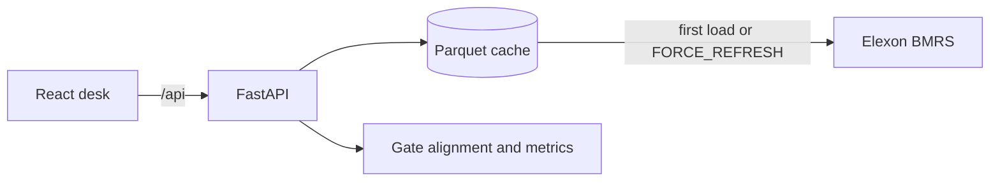

# Windgate

Day-ahead wind desk for a GB energy supplier. It shows the national wind forecast the trading desk could actually use when the day-ahead order book closed, scores that forecast against metered generation, and turns the miss into the thermal or balancing energy that had to be bought.

The delivery window is January 2026 only. Actuals come from Elexon [FUELHH](https://bmrs.elexon.co.uk/api-documentation/endpoint/datasets/FUELHH/stream) (`fuelType=WIND`). Forecasts come from Elexon [WINDFOR](https://bmrs.elexon.co.uk/api-documentation/endpoint/datasets/WINDFOR/stream). Nothing else is used.

This repository was built with assistance from Cursor, an AI coding agent. The gate rule, the Elexon requests, the half-hour alignment, and the error maths were implemented in this codebase and checked against the January 2026 streams and the unit tests in `backend/tests`.

## What the desk decides

GB day-ahead power for delivery day D is bought on D−1. A wind forecast published after the auction has closed is not a number the bid can use.

For each half-hour on day D, Windgate keeps the latest WINDFOR publication strictly before the chosen gate on D−1. That series is the operational baseline. A later publication, still issued before the settlement period starts, is shown as the intraday revision.

WINDFOR in this month is hourly. The regular UTC publication clocks are 02:30, 04:30, 07:30, 09:30, 11:30, 15:30, 18:30 and 22:30, and some days also carry a 12:25 run. The desk reads the clocks from the file rather than assuming them. The gate therefore changes which vintage is legal:

| Gate | Market | Last WINDFOR run the desk can use |
| --- | --- | --- |
| 09:20 UTC | EPEX SPOT GB 60-minute auction | 07:30 |
| 09:50 UTC | Nord Pool N2EX day-ahead auction | 09:30 |
| 11:00 UTC | Reference cut-off from the brief | 09:30 |
| 12:00 UTC | Reference cut-off from the brief | 11:30 |
| 15:30 UTC | EPEX SPOT GB 30-minute auction | 11:30 (a file stamped exactly 15:30 is not strictly before the gate) |

The default gate is 11:00 UTC, the primary example in the brief. The desk can switch gates without refetching Elexon.

FUELHH is already half-hourly. WINDFOR is hourly. Each hourly megawatt value is held across both settlement periods in that clock hour. Energy is unchanged: `P MW × 1 h = 2 × (P MW × 0.5 h)`.

January 2026 is GMT for the whole month, so UTC and UK settlement time are the same. A summer month would need `Europe/London`.

## How the numbers are defined

`F` is the gate forecast in MW. `A` is metered wind in MW. Both are averages over the half-hour.

- MAE = mean(|F − A|)
- RMSE = sqrt(mean((F − A)²))
- MAPE = mean(|F − A| / |A|) × 100, skipping actuals below 1 MW
- Bias = mean(F − A). Positive means the forecast was high and the desk was short of wind.
- Shortfall energy = sum(max(F − A, 0)) × 0.5 h. This is the thermal or balancing volume required to replace wind that was counted on and did not arrive.
- Surplus energy = sum(max(A − F, 0)) × 0.5 h.
- Recommended thermal procurement is that shortfall energy over the selected window.
- Recommended reserve is the 90th percentile of the half-hourly shortfall in MW: a standing buffer that would have covered 90% of periods in the window.

There is no demand series in the brief, so the product does not invent a consumer load. The procurement figure is the wind gap versus the position locked at the gate.

## Directory layout

```
backend/
  render.yaml              Render web service for this folder.
  runtime.txt              Python 3.12 for Render.
  Dockerfile               API image, if you deploy the container instead of native Python.
  .env.example
  requirements.txt
  requirements-dev.txt
  app/
    main.py                FastAPI app, CORS, optional static hosting.
    config.py              January window, gate presets, cache paths.
    present.py             JSON shaping.
    api/routes.py          /api/summary, /api/timeseries, /api/accuracy, /api/gates, /api/meta.
    services/
      elexon_client.py     FUELHH and WINDFOR fetch, with retries on 429 and 5xx.
      store.py             Parquet cache and in-memory frames per gate.
      alignment.py         Half-hour expansion and day-ahead / intraday selection.
      metrics.py           MAE, RMSE, MAPE, bias, shortfall, daily and settlement-period breakdowns.
  tests/test_gate.py       Gate selection, leak prevention, and metric maths.

frontend/
  vercel.json              Vercel build when the project root is this folder.
  .env.example             Set VITE_API_BASE_URL to the Render URL.
  Dockerfile               Optional nginx image. Vercel does not use it.
  nginx.conf
  src/
    App.jsx                Desk layout and data loading.
    api.js                 Client for the four analytical endpoints.
    components/            KPI cards, charts, heatmap, tables, gate comparison.
```

Cached parquet files live in `backend/data`. They are not committed. The first start downloads January from Elexon and writes the cache. Later starts read the files. Set `FORCE_REFRESH=1` to ignore the cache.

## Run it locally

From this directory:

```powershell
python -m pip install -r backend/requirements.txt
python -m uvicorn app.main:app --app-dir backend --reload --port 8000
```

```powershell
cd frontend
npm install
npm run dev
```

The Vite dev server proxies `/api` to `127.0.0.1:8000`. Open [http://localhost:5173](http://localhost:5173).

Tests, from `backend`:

```powershell
python -m pip install -r requirements-dev.txt
python -m pytest
```

Example request:

```powershell
curl "http://127.0.0.1:8000/api/summary?start=2026-01-01&end=2026-01-31&gate=11:00"
```

`gate` is any `HH:MM` UTC time on D−1. The UI offers the five presets above.

## API

| Path | Role |
| --- | --- |
| `GET /api/summary` | Total metered generation, gate-forecast energy, MAE, RMSE, MAPE, bias, thermal procurement, P90 reserve. |
| `GET /api/timeseries` | Half-hourly actual, gate forecast, and intraday revision. Ranges of three days or fewer also include the other published vintages. |
| `GET /api/accuracy` | Error histogram, daily breakdown, and per-settlement-period bias and MAE. |
| `GET /api/gates` | The same window scored at each auction gate, so the vintage and the thermal volume can be compared. |
| `GET /api/meta` | Coverage, observed WINDFOR clocks, and the formulas. |
| `GET /api/health` | Process up. `dataset` is `elexon` or `cache`. |

Query parameters for the analytical routes are `start`, `end` (both inside January 2026), and `gate`.

## Architecture



The browser never calls Elexon. One process downloads the month, writes parquet, and serves every gate from memory. Date changes only slice that frame. Gate changes recompute the selection, which is a pandas pass over about twenty thousand forecast rows.

The React app is a single desk: date window, gate, KPI cards, auction comparison, actual-versus-forecast chart, shaded procurement gap, error histogram, daily trend, settlement-period heatmap, and a daily table. Times are rendered in UTC so a browser in another timezone does not shift settlement period 1 off midnight.

Production is the `backend` folder on Render and the `frontend` folder on Vercel.

## Deploy

Two folders, two hosts. Deploy the API first, then the desk, because the frontend build bakes in the API URL.

### Backend on Render — folder `backend`

1. New Web Service from this repo.
2. Root Directory: `backend`.
3. Runtime: Python 3. `runtime.txt` pins 3.12.8.
4. Build command: `pip install -r requirements.txt`
5. Start command: `uvicorn app.main:app --host 0.0.0.0 --port $PORT`
6. Health check path: `/api/health`

`backend/render.yaml` describes the same service. After the first boot, open `https://<your-service>.onrender.com/api/health`. The first start downloads January from Elexon, so give it a minute. A free instance sleeps when idle and fetches again on the next wake.

### Frontend on Vercel — folder `frontend`

1. New Project from this repo.
2. Root Directory: `frontend`. Framework preset: Vite. `frontend/vercel.json` sets the build.
3. Environment variable, set before the build:

```
VITE_API_BASE_URL=https://<your-service>.onrender.com
```

No trailing slash. Vite reads that value at build time, so change it and redeploy if the Render URL changes. The API allows cross-origin GET requests.

Open both URLs in a private window. `/api/health` must answer, and the Vercel app must show January data.

## Submission pieces this repo cannot invent

- An unlisted YouTube video, at most 10 minutes: five minutes pitching the desk to the utility, then five minutes walking a technical reviewer through the gate rule, the cache, and the metric code.
- A public GitHub repository with an anonymous name.
- The challenge form, with those links opened in a private window first.
